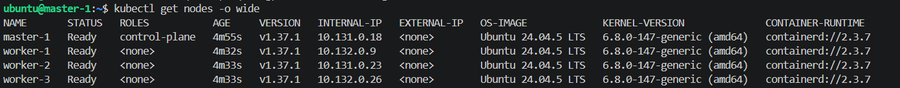
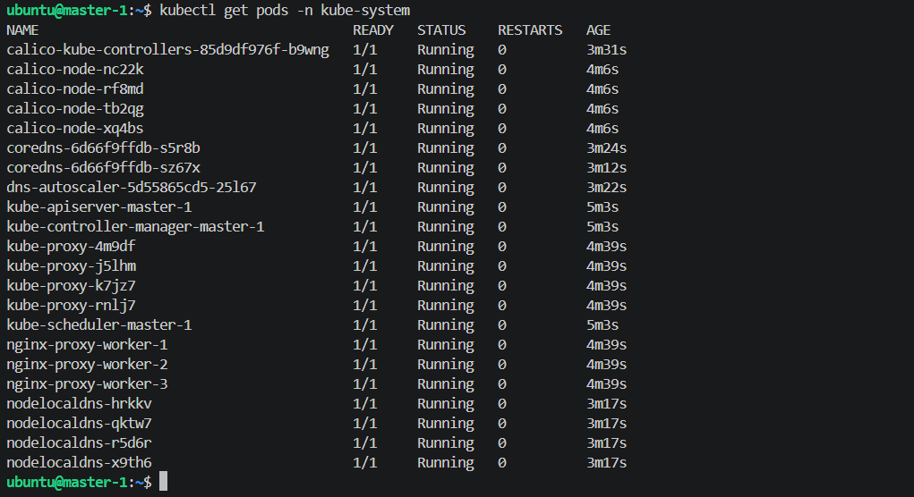

# Домашнее задание к занятию «Установка Kubernetes» - Рыбянцев Павел

Репозиторий содержит файлы автоматизации и описание процесса развёртывания отказоустойчивого гео-распределённого кластера Kubernetes в облачной инфраструктуре **Yandex Cloud** с помощью инструментов **Terraform** и **Ansible (Kubespray)**.

---

## 1. Архитектура решения и IaC-пайплайн

Развёртывание кластера выполнено по схеме автоматической генерации инвентаря:
1. **Terraform** разворачивает сетевую топологию (сеть, подсети, группы безопасности и NAT-шлюз) и создаёт 4 виртуальные машины на платформе `standard-v2` под управлением Ubuntu 24.04 LTS (старая платформа 20.04 не поддерживается сейчас в яндексе).
2. Проект спроектирован как **гео-распределённый (Multi-AZ)** кластер для защиты от физических инцидентов в ЦОД: ноды распределены между зонами доступности `ru-central1-d` и `ru-central1-e`.
3. Доступ в кластер организован по схеме **Бастион-хоста**: публичный IP выдан только ноде `master-1`. Рабочие ноды (`worker-1, 2, 3`) остаются в приватном контуре, а Ansible настраивает их через сквозное SSH-туннелирование (`ProxyCommand`). Выход приватных нод в интернет для скачивания пакетов и образов настроен через **Yandex NAT Gateway**.
4. На основе выданных IP-адресов Terraform автоматически генерирует готовый файл инвентаря `hosts.ini` для Ansible.
5. **Kubespray** производит установку кластера: в качестве CRI настраивается `containerd`, сетевым плагином выступает `Calico` (для межзонной маршрутизации принудительно переведён в режим инкапсуляции `VXLAN`).

---

## 2. Пошаговое руководство по развёртыванию кластера

### Шаг 2.1. Подготовка инфраструктуры через Terraform
Находясь на локальной управляющей машине, инициализируем провайдеров и запускаем создание ресурсов в Yandex Cloud:
```bash
# Инициализация и скачивание плагинов Yandex
terraform init

# Создание сети, подсетей, ВМ и автоматическая генерация hosts.ini
terraform apply -auto-approve
```

### Шаг 2.2. Настройка окружения Kubespray и зависимостей
Активируем локальное виртуальное окружение Python, доставляем необходимые системные зависимости и коллекции Ansible для корректной работы сетевых фильтров и криптографии:
```bash
# Переходим в директорию со склонированным Kubespray
cd kubespray

# Активируем виртуальное окружение Python
source ~/myenv/bin/activate

# Установка базовых зависимостей из репозитория
pip3 install -r requirements.txt

# Доустановка необходимых внешних коллекций Ansible и модулей
ansible-galaxy collection install kubernetes.core
ansible-galaxy collection install ansible.utils
ansible-galaxy collection install community.crypto
pip install netaddr --upgrade
```

### Шаг 2.3. Запуск инсталляции кластера Kubernetes
Добавил SSH-ключ в агент для прозрачной работы ProxyCommand-туннелей до приватных воркеров. Флаг `ignore_assert_errors=yes` используется для игнорирования проверок минимального объёма RAM (выделено по 2 ГБ на ноду):
```bash
# Добавление приватного ключа в локальный SSH-агент
eval \$(ssh-agent -s)
ssh-add ~/.ssh/id_ed25519

# Запуск основного плейбука Kubespray
ansible-playbook -i inventory/mycluster/hosts.ini \
  --become --become-user=root \
  -e ignore_assert_errors=yes \
  --private-key=~/.ssh/id_ed25519 \
  --ssh-common-args="-o IdentitiesOnly=yes -i ~/.ssh/id_ed25519" \
  cluster.yml
```

---

## 3. Результаты проверки работоспособности кластера

После успешного завершения Ansible-плейбука выполнена проверка состояния компонентов кластера непосредственно на мастер-ноде.

Для настройки утилиты `kubectl` на `master-1` были применены следующие команды:
```bash
mkdir -p \$HOME/.kube
sudo cp -i /etc/kubernetes/admin.conf \$HOME/.kube/config
sudo chown \$(id -u):(id -g) HOME/.kube/config
```

### 3.1 Статус узлов кластера (Nodes)
Все 4 ноды (1 Master + 3 Workers) успешно инициализированы, установили сетевое соединение через Calico VXLAN и находятся в статусе **Ready**:

```bash
kubectl get nodes -o wide
```


### 3.2 Статус системных компонентов (Pods)
Все служебные поды и CNI-плагин внутри пространства имён `kube-system` запущены и функционируют в штатном режиме без единого рестарта:

```bash
kubectl get pods -n kube-system
```



---

## Вывод
Задачи по автоматизированному развёртыванию production-ready кластера Kubernetes выполнены в полном объёме. Использование связки Terraform + Kubespray обеспечивает декларативность инфраструктуры (IaC) и повторяемость среды.
